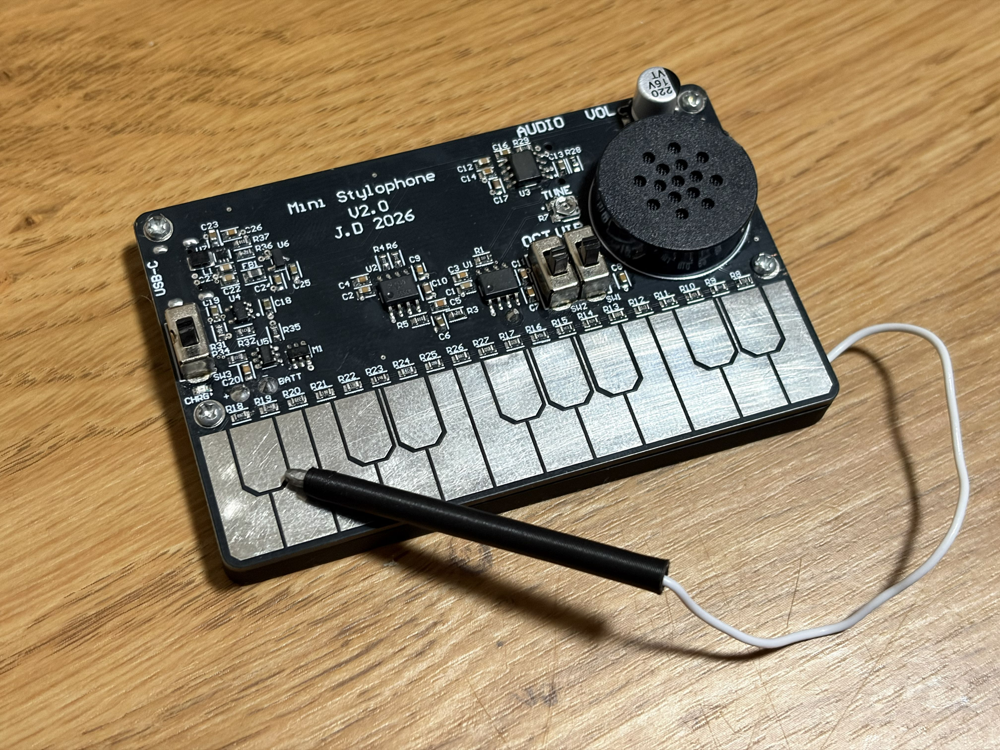
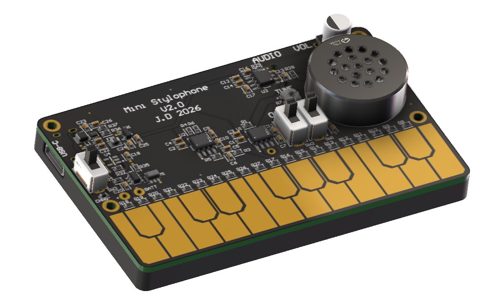

# Mini Stylophone V2

A credit-card-sized analog synthesiser based on the 1960s Stylophone. Touching a stylus to one of 20 copper key pads taps a resistor ladder that sets the pitch of a 555 oscillator. Designed in Altium Designer as an educational project to deepen my understanding of analog electronics and learn PCB design and SMD soldering.

| Built | Render |
|---|---|
|  |  |

## Features

- 20-note chromatic keyboard (A3–E5) with octave switch
- Vibrato from a second 555 low-frequency oscillator
- LM386 amplifier with on-board speaker and headphone jack
- Rechargeable LiPo cell with USB-C charging, battery protection and a boost + LDO 5 V supply
- Volume and tuning controls

## Repository

| Folder | Contents |
|---|---|
| [`docs/`](docs) | Schematic PDF, photos and renders |
| [`hardware/altium/`](hardware/altium) | Altium project (schematics and PCB) |
| [`hardware/fabrication/`](hardware/fabrication) | Gerbers |
| [`mechanical/`](mechanical) | SolidWorks files and STEP models of the base, stylus and PCB |

## Changes from V1

- Replaced USB power with a rechargeable LiPo cell + charging, protection, and regulation circuitry
- Added octave switch and headphone jack
- Added pullup on timing input
- Resistor ladder recalculated with 1% E96 values for better tuning
- Switched to CMOS LMC555 timers, with a 50% duty cycle topology for the tone generator

---

Jonathan Duncan, 2026
